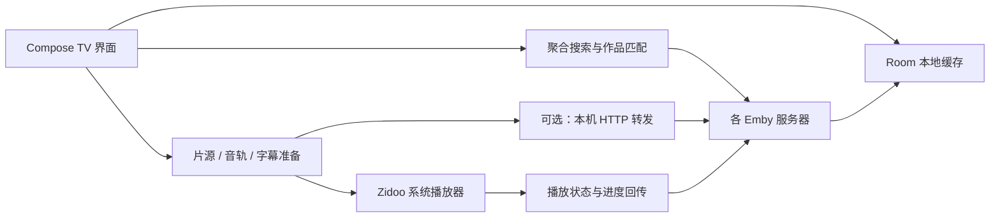

<p align="center">
  
</p>

<h1 align="center">zmby</h1>

<p align="center"><strong>把多个 Emby 媒体库，放进同一个电视界面。</strong></p>
<p align="center">Android TV · Kotlin · Jetpack Compose · Zidoo 系统播放器</p>
<p align="center"><a href="#开始使用">开始使用</a> · <a href="#从源码构建">源码构建</a> · <a href="#本地演示">本地演示</a> · <a href="#参与开发">参与开发</a> · <a href="LICENSE">GPL-3.0-or-later</a></p>


zmby 是一个为芝杜（Zidoo）设备开发的 Emby 多服务器客户端。你可以在一个地方浏览媒体库、搜索影片、挑选不同服务器上的版本，再交给设备上的 Zidoo 播放器播放。应用直接连接你添加的 Emby 服务器，无需另搭聚合服务。

> 当前版本：**0.2.0，早期开发阶段**。主要目标设备为 Zidoo Z9X 8K（Android 11）。部分播放行为依赖设备固件；模拟器走查不能代替真机验收。
>
> 本页均为 Android TV 模拟器中的实际应用截图。服务器、账号和条目来自仓库自带 mock，封面与背景由程序生成；不包含真实媒体资源或第三方影视图片。

## 可以做什么

| 功能 | 使用方式 |
| --- | --- |
| 多服务器首页 | 汇总继续观看、下一集与最近更新，也可以切换到某台服务器的首页。 |
| 聚合搜索与版本选择 | 并发查询多台服务器，依据外部 ID 等信息匹配作品，在详情页选择片源版本。无法确定的匹配保留区别。 |
| 遥控器操作 | 针对大屏设计的焦点、横向卡片、排序筛选与剧集选集；支持中文拼音候选。 |
| 本地收藏与待看 | 收藏以本地为准，可按服务器选择同步策略；待看在开始播放后自动移出。 |
| 影视数据库与演员 | 直连 TMDB / Bangumi，按人物 ID 展示演员与作品；番剧可用 bangumi-data 的原名和简繁别名定位。 |
| 完整季集目录 | TMDB / Bangumi 的季集独立于片源服务器展示；缺资源标记「暂无资源」，无法映射的服务器条目单列。 |
| 图片与语言 | 分别设置元数据、海报、Logo 语言，精确匹配地区 / 简繁标记，缺失回退原语言。 |
| TMDB 首页轮播 | 在设置选择趋势、热映、热门、高分或播出榜单，无资源的作品也能打开详情。 |
| 本地缓存 | 首页、收藏、待看、资源快照与外部数据库资料先显示缓存，再后台刷新；设置中分别控制元数据与图片缓存上限。 |
| 数据来源控制 | 按功能选择请求哪些服务器，管理多线路、优先级、媒体库开关和服务器健康状态。 |
| 播放与回传 | 交给 Zidoo 播放器，向片源所属的 Emby 服务器回传开始、进度和停止事件。 |
| 片头片尾跳过 | 按「片段标记来源」的顺序取本地手动标记、Emby 章节标记、TheIntroDB、IntroDB、PublicMetaDB（需自备 key），播放中自动跳过；外部数据库只用影片的外部 ID 查询。 |
| 连播与自动换源 | 剧集看完后倒计时播放下一集，沿用服务器与音轨字幕语言；版本打不开时按默认版本顺序换到下一个并提示。 |
| 观影统计 | 汇总所选服务器的已看记录：部数、集数、时长与按月分布，先显示本地再刷新。 |
| 字幕与流地址处理 | 支持音轨/字幕偏好、本地 STRM 外挂字幕流程；按服务器选择是否开启本机 HTTP 转发。 |
| 手机导入与备份 | 局域网网页批量添加，兼容 AFuseKt 导出；配置可加密备份，并预览合并或替换恢复。 |

<table>
  <tr>
    <td width="50%"><br><strong>浏览媒体库</strong> · 按服务器和媒体库找片。</td>
    <td width="50%"><br><strong>选择片源</strong> · 同一作品的不同版本集中展示。</td>
  </tr>
  <tr>
    <td width="50%"><br><strong>遥控器搜索</strong> · 中文片名与拼音候选。</td>
    <td width="50%"><br><strong>按需设置</strong> · 播放、字幕、来源与本地缓存。</td>
  </tr>
</table>

## 开始使用

需要一台能运行本应用的 Android 设备，以及你有权使用的 Emby 服务器与账号。最低 Android 9（API 28）；完整播放流程面向装有 Zidoo 系统播放器的设备。普通 Android TV 和模拟器可以用于浏览与开发，不能保证播放功能。

1. 从 [GitHub Releases](https://github.com/zhenyuefu/zmby/releases) 下载 APK，或[从源码构建](#从源码构建)，再通过 ADB 或设备的安装工具侧载。
2. 在「服务器」中添加 Emby 地址、用户名和密码，或打开手机导入页批量添加。
3. 多台服务器可分别配置线路、媒体库开关、参与聚合与收藏同步策略。
4. 在「设置 → 数据来源」中选择各项功能的服务器来源。
5. 在「设置 → 元数据与图片」填写自己的 **TMDB API Read Access Token**，分别选择文字、海报、Logo 语言与首页榜单。没有填写时仍能使用 Emby；TMDB 搜索和轮播需要凭据。凭据保存在应用私有偏好中，不加入 URL 或日志。
6. 打开影片或剧集详情，选版本、音轨和字幕，确认播放。目录中的「暂无资源」仍可浏览；未映射条目可单独展开查看。

电视上使用方向键移动焦点，确认键进入或执行，返回键回到上一层。影片卡片支持菜单键快捷操作。

### 当前边界

- 解码、HDR/Dolby Vision 和音频直通由 Zidoo 播放器与硬件决定，zmby 不提供独立解码器，也不执行转码。
- 观看进度回传到当前片源服务器；跨服务器统一续播尚未实现。
- 拼音候选来自本地已见条目及实时搜索结果。服务器无拼音支持、本地也未见过的片名，不保证能用首字母搜到。
- 302 签名直链换链、真实高码率转发、HTTP 原盘 ISO/BDMV 和各固件的字幕行为仍需更多真机验证。
- Z9X 8K 上首页冷启动与行滚动已基本达到性能目标（仍有少量长帧），浏览页、详情页尚未实测；Baseline Profile 是手写规则。
- 片头片尾跳过由 zmby 通过播放器的本机控制接口跳转，跳转在进入片段后约一秒内发生；Zidoo 播放器 1.3.60 本身不使用 `skipOpening` 等跳过参数。
- 暂不支持音乐、有声书、直播、服务器管理和 SMB/NFS 直连。

### 影视资料与季集匹配

规范资料来自 TMDB / Bangumi，始终在原有的电影与剧集详情页内更新，保留选季、选集和遥控位置。列表已带回 TMDB ID 时，立即取数据库资料，并发查找服务器片源；数据库先返回就直接显示，不先请求服务器简介或演员。缺 ID 时先轻量补查，仍无法定位或数据库不可用时才读取服务器完整资料；较慢时可以先显示已有的条目快照。作品、演员与图片不再向所有 Emby 服务器补拉择优；Emby 仍用于查询资源、播放与回传进度。元数据缓存按提供方、ID 和完整地区语言分开，升级会清理旧的服务器合并视图，保留收藏、待看与资源 / 观看记录。

海报和 Logo 优先精确语言地区，缺失时回退作品原语言；无法确认简繁的通用 `zh` 图片不会冒充 `zh-CN`。已用公开 API 核验 `language=zh-CN` / `zh-TW` 和 `include_image_language` 的地区筛选，图片对象通过 `iso_639_1` 与 `iso_3166_1` 区分语言及地区；选图时再做客户端精确校验。

`bangumi-data/bangumi-data` 提供原名、译名与 Bangumi 入口，并不是 TMDB / Bangumi 的逐季逐集偏移表。分季关系不明确时保留独立目录与 TMDB 候选入口，不猜测集数偏移。只有已确认同一作品的服务器资源才进入规范目录；缺 ID、冲突 ID、重复或非法集号保留在「未匹配条目」。服务器未响应时显示待确认，可重试。

### 添加服务器与配置备份

服务器页的「扫码导入」打开局域网页面，手机、平板和电脑都能使用。可粘贴分享信息、手动填写，或选择 AFuseKt 的 `media_server_export.json`；只导入 Emby 配置，保留账号和命名线路，核对后点击「登录并添加到电视」。密码仅用于这次登录。

在「服务器 → 备份与恢复」导出名称、线路和优先级，并选择是否包含账号名、登录令牌、服务器设置及应用设置。包含令牌或应用 API 凭据时须设置至少 8 位备份密码，正文以 PBKDF2-HMAC-SHA256 与 AES-256-GCM 加密。备份文件请自行保管，恢复时仍需原备份密码。

可通过网页下载、上传，保存到本机 Download/zmby（最多保留最近 10 份），或首次授权 U 盘目录后写入其中的 zmby 文件夹。Android 9 保存到本机时会请求存储权限。恢复前显示逐台预览；「合并到现有」保留当前线路并合并新线路，「全部替换」需再确认一次。令牌失效的服务器保留并提示扫码重新登录。备份包含配置，不包含收藏、待看、观看记录和图片缓存。

### 本地缓存容量

在「设置 → 本地缓存」分别设置元数据和图片缓存上限，并查看已用容量：

- 元数据：32 MB～1 GB，默认 **128 MB**。修改后立即按最近使用顺序清理超出部分，后续写入也受上限约束。
- 图片：100 MB～2 GB，默认 **300 MB**。修改后需**重启应用**生效，随后按最近使用顺序清理超出部分。

上限分别按元数据内容和图片文件计算，不包含收藏、待看、观看记录及登录配置；这些记录单独保留。元数据数据库还含索引、日志与可复用空间，文件实际大小可能大于缓存内容容量。超过单条缓存预算的响应仍可显示，但不会保存到磁盘。

### 数据与隐私

应用直连 TMDB、Bangumi 与提供 bangumi-data 的 jsDelivr / unpkg，查询会向相应提供方发送影视 ID、搜索词或语言偏好；不会发送 Emby 地址、登录令牌或账号。

应用将服务器地址、登录令牌、偏好与缓存保存在应用私有目录中，当前服务器令牌未额外加密；系统备份已关闭。播放 URL 可能携带令牌，并传给外部播放器。请勿分享包含真实登录信息的配置、播放地址、数据库或设备备份。

应用提供局域网日志与手机导入 HTTP 页面，默认从 `8790` 端口起尝试绑定。日志接口限制局域网来源但没有登录认证；密码、令牌与常见签名参数会脱敏，日志仍可能包含服务器域名、片名和设备信息。仅在可信局域网中使用，不要将端口映射到公网。手机导入使用 HTTP，导入码不能替代传输加密。

## 从源码构建

工具链：**JDK 21**、**Android SDK Platform 36**。Gradle Wrapper 固定为 **8.14.3**，无需全局安装 Gradle。应用 `minSdk 28` / `targetSdk 30`；当前目标是侧载到芝杜设备。

设置 `JAVA_HOME` 与 `ANDROID_HOME`，或在不提交的 `local.properties` 中配置 `sdk.dir`。macOS/Linux 执行：

```bash
./gradlew :app:testDebugUnitTest :app:assembleDebug
adb install -r app/build/outputs/apk/debug/app-debug.apk
```

Windows 可将 `./gradlew` 换成 `gradlew.bat`。macOS 上已有 mise 的开发者也可使用仓库的 `mise.toml`（其中 SDK 路径为 macOS 默认位置）：

```bash
mise install
mise exec -- ./gradlew :app:testDebugUnitTest :app:assembleDebug
```

构建经过 R8 压缩的版本：

```bash
./gradlew :app:assembleRelease
```

未提供签名配置时，产物为 `app/build/outputs/apk/release/app-release-unsigned.apk`。正式发布使用独立发布密钥，通过 `ZMBY_SIGNING_PROPERTIES` 指向仓库外的私有配置：

```properties
storeFile=release.p12
storePassword=<your-store-password>
keyAlias=zmby-release
keyPassword=<your-key-password>
```

`storeFile` 相对于该配置文件所在目录，也可使用绝对路径。配置完成后构建：

```bash
ZMBY_SIGNING_PROPERTIES=/path/outside/repo/release.properties ./gradlew :app:assembleRelease
```

签名产物为 `app/build/outputs/apk/release/app-release.apk`。密钥与密码请单独备份，不要提交到 Git。GitHub Release APK 使用固定发布签名；从此前 debug 签名的开发版切换时，需要先卸载旧版（应用数据会随之删除）。

## 本地演示

没有真实服务器时，可使用自带 Python mock。仅需 Python 3 标准库：

```bash
python3 -I tools/mock_emby.py --multi
```

在 Android TV 模拟器中添加 `http://10.0.2.2:8096`，用户名和密码任意。额外服务器端口为 `8098`–`8102`，模拟多译名、缺失 ID、收藏拒写、慢服务器、离线和客户端限制。mock 会监听宿主机网络端口，只在可信的开发网络运行，结束后用 Ctrl+C 停止。

需要模拟外部播放器与进度回传时：

```bash
./gradlew :devtools:fake-zidoo-player:assembleDebug
adb -s emulator-5580 install -r devtools/fake-zidoo-player/build/outputs/apk/debug/fake-zidoo-player-debug.apk
adb -s emulator-5580 reverse tcp:9529 tcp:9529
```

将 `emulator-5580` 换成 `adb devices` 中的模拟器序列号。假播放器只用于验证 Intent 与进度协议，不解码视频。**不要安装到真实 Zidoo 设备上**：它使用系统播放器的兼容包名，可能发生冲突。

mock 还支持 `--pinyin`、`--redirect`、`--sign-ttl`、`--require-ua` 和 `--video`；用 `python3 -I tools/mock_emby.py --help` 查看参数。真实播放测试请使用你有权分发的测试视频，仓库不附带影片。

## 代码结构



| 目录 | 职责 |
| --- | --- |
| `app/src/main/java/app/zmby/ui/` | 页面、导航、遥控焦点与 Compose 组件。 |
| `aggregate/`、`search/` | 并发扇出、作品合并、版本排序与拼音搜索。 |
| `emby/`、`data/` | Emby API、服务器注册表、媒体库与设置。 |
| `store/`、`favorites/` | Room 数据、元数据合并、收藏与待看。 |
| `playback/`、`zidoo/` | 播放准备、流地址、字幕、转发和 Zidoo 协议。 |
| `log/`、`net/` | 脱敏日志与小型 HTTP 服务。 |
| `app/src/test/` | JUnit、MockWebServer 与 Robolectric 测试。 |
| `devtools/fake-zidoo-player/`、`tools/mock_emby.py` | 模拟器测试工具。 |

表中包名目录均相对于 `app/src/main/java/app/zmby/`，完整目录除外。

## 参与开发

开发约定见 [AGENTS.md](AGENTS.md)。提交前执行与改动相关的测试；完整本地检查：

```bash
./gradlew :app:testDebugUnitTest :app:lintDebug :app:assembleDebug :app:assembleRelease
```

修复播放问题时请提供设备型号、固件版本、复现步骤、预期与实际行为，并说明使用 mock 还是真实服务器。提交日志前请手工复查脱敏结果；不要公开账号、令牌、签名链接或私人服务器地址。

当前已知静态检查问题：`lintDebug` 在 `MediaStorePlaybackStore.kt` 的 API 29 使用声明，以及 `MainActivity.kt` 的 `RestrictedApi` / `ContextCastToActivity` 上报告共 5 个错误；它们需要后续修复。单元测试与 APK 构建通过不代表 Lint 通过。

## 许可与致谢

Copyright © 2026 zmby contributors。项目自有源码与配图依据自由软件基金会发布的 **GNU General Public License 第 3 版，或由你选择的更新版本**分发，全文见 [LICENSE](LICENSE)。第三方组件保留各自许可证，见 [THIRD_PARTY_NOTICES.md](THIRD_PARTY_NOTICES.md)。Gradle Wrapper 按其随附的 Apache-2.0 版权与许可声明分发。

项目不提供任何明示或暗示的担保。分发修改版或 APK 时，请遵循 GPL 的许可证、版权声明及对应源码提供要求；随附的第三方组件仍需保留各自必要的许可材料。

影视数据来源：[TMDB](https://www.themoviedb.org)、[Bangumi](https://bgm.tv)；番剧别名来源 [bangumi-data/bangumi-data](https://github.com/bangumi-data/bangumi-data)，数据按 [CC BY 4.0](https://creativecommons.org/licenses/by/4.0/) 使用。This product uses the TMDB API but is not endorsed or certified by TMDB.

感谢 Kotlin、AndroidX / Jetpack Compose、Room、OkHttp、Coil、kotlinx.coroutines、kotlinx.serialization、pinyin4j 和 ZXing 等开源项目。Emby 与 Zidoo 为各自权利人的产品与商标，本项目是独立客户端，与其没有隶属关系。
