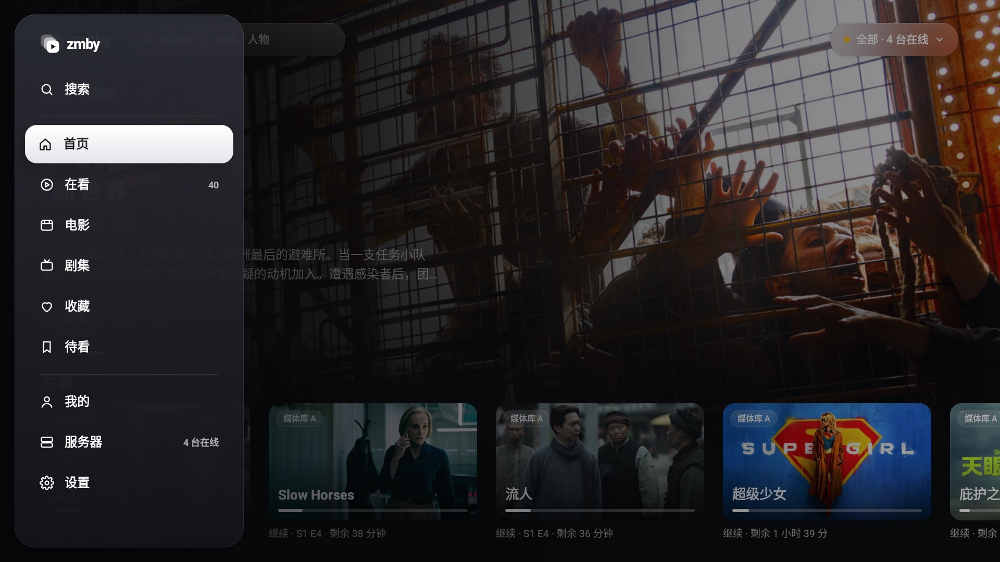
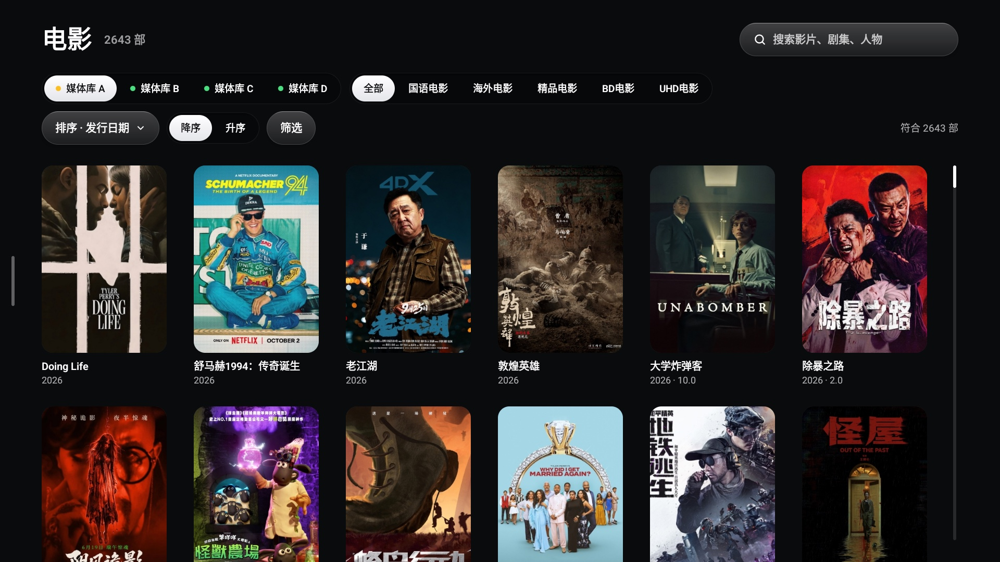
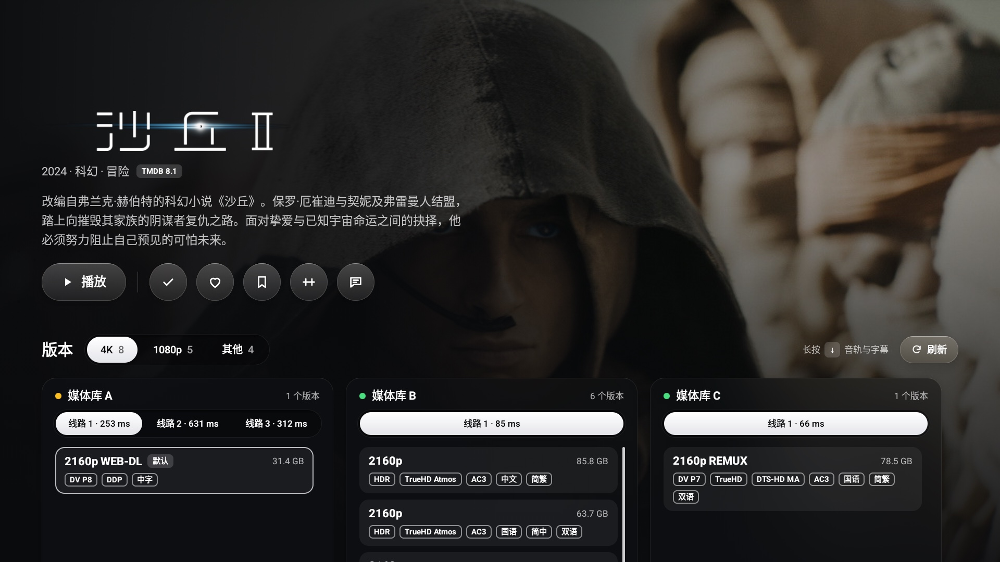
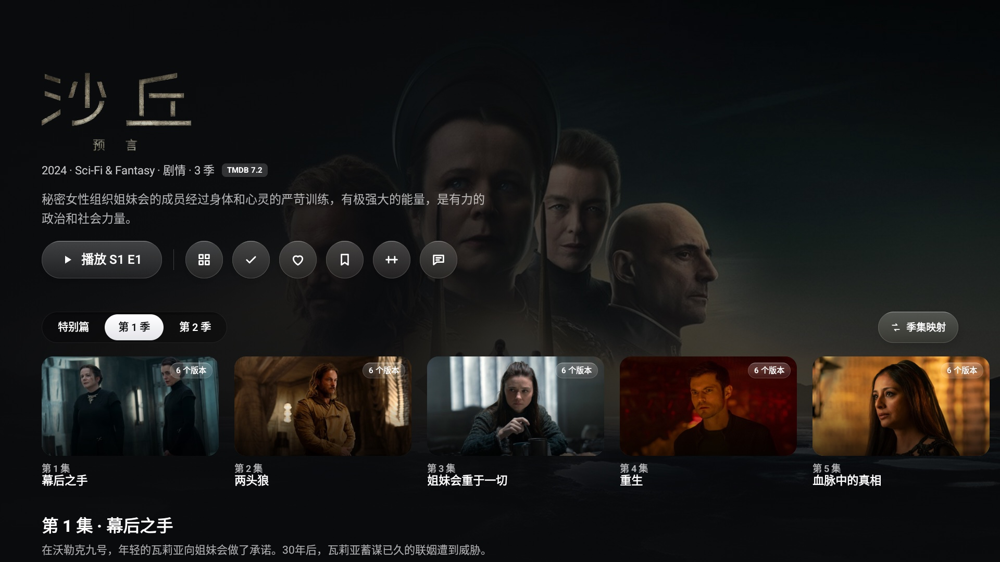
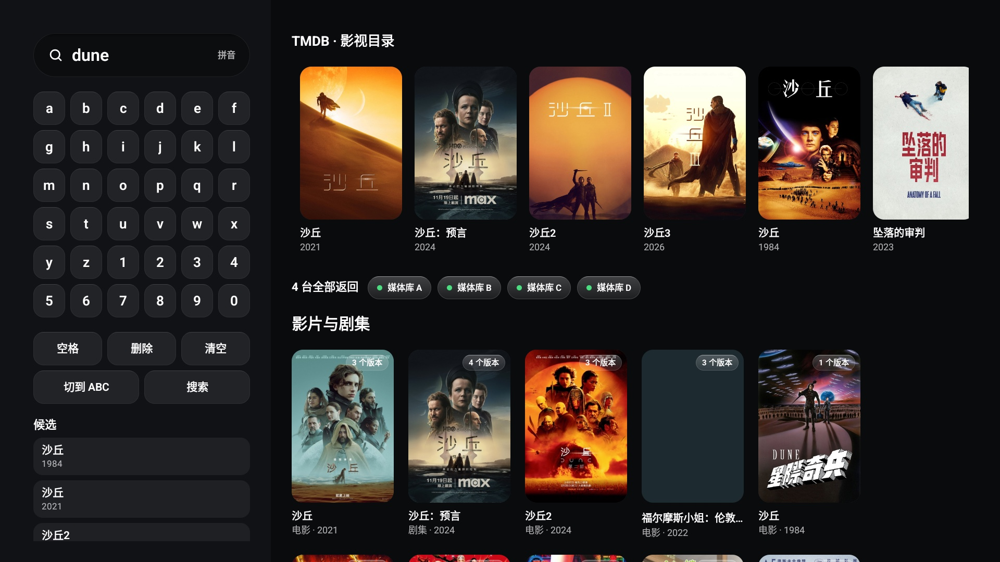
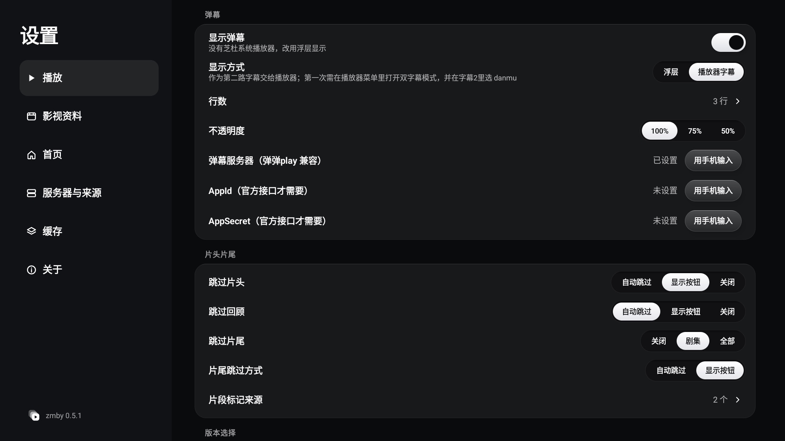

  

<h1 align="center">zmby</h1>

<strong>聚合 Emby 片库，用芝杜系统播放器播放。</strong>

Android TV · 多服务器聚合 · Zidoo 原生播放

<a href="https://github.com/zhenyuefu/zmby/releases/tag/v0.5.3">下载 0.5.3</a> · <a href="#快速开始">快速开始</a> · <a href="docs/USAGE.md">使用指南</a> · <a href="docs/DEVELOPMENT.md">开发指南</a>

zmby 是面向芝杜（Zidoo）的 Android TV Emby 客户端。把多台服务器的片库、版本和观看记录放在一起，选好片源后交给芝杜系统播放器播放。

## 功能

- **多服聚合**：统一浏览、搜索和比较不同服务器的片源，也可切到单台媒体库。
- **芝杜原生播放**：选择版本、音轨和字幕，使用设备的解码、HDR 与音频直通能力。
- **连续追剧**：继续观看、自动连播，下一集延续版本与语言选择。
- **弹幕与跳过**：浮层弹幕或 ASS 第二路字幕、片头片尾标记、下集预取。
- **影视资料**：TMDB / Bangumi 简介、演员、季集目录与榜单。
- **电视操作**：遥控器焦点、快速选集，手机扫码添加服务器和填写 API 配置。

## 界面

以下是 **0.5.1 Android TV 模拟器实拍**，使用真实媒体库与 TMDB 内容；服务器与线路显示名已替换为通用名称。

<table>
  <tr>
    <td width="50%"> <strong>统一入口</strong> · 首页、电影、剧集、在看与收藏。</td>
    <td width="50%"> <strong>浏览片库</strong> · 按服务器、媒体库与类型筛选。</td>
  </tr>
  <tr>
    <td width="50%"> <strong>比较版本</strong> · 画质、格式、音轨和字幕一眼可见。</td>
    <td width="50%"> <strong>接着追剧</strong> · 选季、选集，再挑当前集的片源。</td>
  </tr>
  <tr>
    <td width="50%"> <strong>聚合搜索</strong> · 中文、拼音与多来源候选。</td>
    <td width="50%"> <strong>配置播放</strong> · 弹幕、字幕、跳过与扫码输入。</td>
  </tr>
</table>

## 快速开始

1. 从 [GitHub Releases](https://github.com/zhenyuefu/zmby/releases/latest) 下载 APK，安装到芝杜设备。
2. 打开「服务器 → 扫码导入」，用手机填写服务器信息；也支持 AFuseKt 的 `media_server_export.json`。
3. 在「设置 → 影视资料」扫码填写自己的 TMDB 读取访问令牌，开启资料与榜单。
4. 浏览或搜索影片，在详情页选择服务器版本、音轨和字幕，确认播放。

| 想做什么 | 在哪里设置 |
| --- | --- |
| 添加弹幕服务 | 设置 → 播放 → 弹幕 → 用手机输入 |
| 片头片尾跳过、下一集提示 | 设置 → 播放；详情页可查看和调整标记 |
| 切换参与聚合的服务器 | 设置 → 服务器与来源 |
| 导出或恢复配置 | 服务器 → 备份与恢复 |
| 调整图片、资料缓存 | 设置 → 缓存 |

遥控器用方向键移动、确认键选择、返回键退回；最左侧再按左键可打开导航。更多操作见[使用指南](docs/USAGE.md)。

## 设备与播放

- Android 9 及以上；完整播放功能面向装有系统播放器的芝杜设备，当前主要适配 Z9X 8K（Android 11）。
- 解码、HDR / Dolby Vision 和音频直通由芝杜硬件与固件提供；zmby 不转码。
- 浮层弹幕需授予悬浮窗权限。ASS 弹幕作为第二路字幕，首次需在播放器中开启双字幕并选中 danmu 字幕。
- 观看进度回传实际播放的服务器。设置 › 数据来源 ›「观看进度回写」（默认关闭）可在播放结束后把进度或已看写到所选服务器上已匹配的同一作品；不同剪辑版本只写已看，写入失败不重试，尚未在真实服务器上验证。
- 模拟器可验证浏览与交互，不能代替芝杜真机的播放、字幕与画面合成验证。

## 开发与反馈

构建、测试、本地 mock、代码结构和签名说明见[开发指南](docs/DEVELOPMENT.md)，贡献约定见 [AGENTS.md](AGENTS.md)。

[反馈问题](https://github.com/zhenyuefu/zmby/issues)时，请附设备型号、固件版本和复现步骤；不要公开账号、令牌、私人服务器地址或签名播放链接。

## 许可与致谢

项目自有源码与界面采用 [GPL-3.0-or-later](LICENSE)。第三方组件的许可与归属见 [THIRD_PARTY_NOTICES.md](THIRD_PARTY_NOTICES.md)。截图中的影视海报、剧照与标志归各自权利人所有。

影视资料来自 [TMDB](https://www.themoviedb.org)、[Bangumi](https://bgm.tv)，番剧别名来自 [bangumi-data](https://github.com/bangumi-data/bangumi-data)。This product uses the TMDB API but is not endorsed or certified by TMDB.

Emby 与 Zidoo 为各自权利人的产品与商标，本项目为独立客户端。应用不提供任何明示或暗示的担保。
