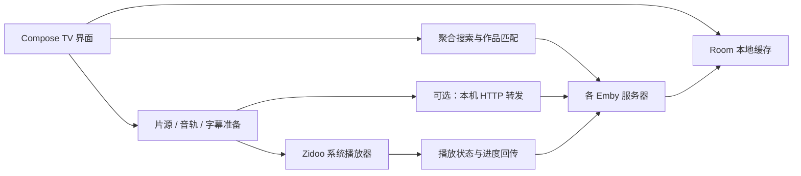

# 开发指南

[返回项目首页](../README.md)。以下命令均在仓库根目录执行。

工具链：**JDK 21**、**Android SDK Platform 36**。Gradle Wrapper 固定为 **8.14.3**，无需全局安装 Gradle。应用 `minSdk 28` / `targetSdk 30`；当前目标是侧载到芝杜设备。

设置 `JAVA_HOME` 与 `ANDROID_HOME`，或在不提交的 `local.properties` 中配置 `sdk.dir`。macOS/Linux 执行：

```bash
./gradlew :app:testDebugUnitTest :app:assembleDebug
adb install -r app/build/outputs/apk/debug/app-debug.apk
```

Windows 可将 `./gradlew` 换成 `gradlew.bat`。macOS 上已有 mise 的开发者也可使用仓库的 `mise.toml`（其中 SDK 路径为 macOS 默认位置）：

```bash
mise install
mise exec -- ./gradlew :app:testDebugUnitTest :app:assembleDebug
```

构建经过 R8 压缩的版本：

```bash
./gradlew :app:assembleRelease
```

未提供签名配置时，产物为 `app/build/outputs/apk/release/app-release-unsigned.apk`。正式发布使用独立发布密钥，通过 `ZMBY_SIGNING_PROPERTIES` 指向仓库外的私有配置：

```properties
storeFile=release.p12
storePassword=<your-store-password>
keyAlias=zmby-release
keyPassword=<your-key-password>
```

`storeFile` 相对于该配置文件所在目录，也可使用绝对路径。配置完成后构建：

```bash
ZMBY_SIGNING_PROPERTIES=/path/outside/repo/release.properties ./gradlew :app:assembleRelease
```

签名产物为 `app/build/outputs/apk/release/app-release.apk`。密钥与密码请单独备份，不要提交到 Git。GitHub Release APK 使用固定发布签名；从此前 debug 签名的开发版切换时，需要先卸载旧版（应用数据会随之删除）。

## 本地演示

没有真实服务器时，可使用自带 Python mock。仅需 Python 3 标准库：

```bash
python3 -I tools/mock_emby.py --multi
```

在 Android TV 模拟器中添加 `http://10.0.2.2:8096`，用户名和密码任意。额外服务器端口为 `8098`–`8102`，模拟多译名、缺失 ID、收藏拒写、慢服务器、离线和客户端限制。mock 会监听宿主机网络端口，只在可信的开发网络运行，结束后用 Ctrl+C 停止。

需要模拟外部播放器与进度回传时：

```bash
./gradlew :devtools:fake-zidoo-player:assembleDebug
adb -s emulator-5580 install -r devtools/fake-zidoo-player/build/outputs/apk/debug/fake-zidoo-player-debug.apk
adb -s emulator-5580 reverse tcp:9529 tcp:9529
```

将 `emulator-5580` 换成 `adb devices` 中的模拟器序列号。假播放器只用于验证 Intent 与进度协议，不解码视频。**不要安装到真实 Zidoo 设备上**：它使用系统播放器的兼容包名，可能发生冲突。

mock 加 `--many-tracks` 可让「沙丘：第二部」的 REMUX 版本提供 25 条音轨与 60 条字幕，用于验证卡内滚动。

mock 加 `--segments` 给「漫长的季节」各集加片头片尾标记，并让「奥本海默」有三个时长不同的版本（院线 180 分、加长 200 分、IMAX 190 分），各带自己的标记：前两个把章节列在版本上，IMAX 只在以 `ItemId` 取到的自身条目上，用于验证按播放版本取 Emby 标记。

宿主机代理或 VPN 拦截模拟器访问 `10.0.2.2` 时，可改走 adb 反向端口：`adb reverse tcp:8096 tcp:8096`，在服务器管理里给 mock 服务器添加线路 `127.0.0.1:8096`，并用 `adb shell setprop debug.zmby.fake_zidoo_base http://127.0.0.1:8096` 让假播放器回报状态。

mock 还支持 `--pinyin`、`--redirect`、`--sign-ttl`、`--require-ua`、`--video` 和 `--suggestions`（主推区建议接口的有无），并提供相似作品、建议、电影推荐与一个只接受假令牌的最小 TMDB（调试构建用 `adb shell setprop debug.zmby.tmdb_base http://10.0.2.2:8096/_mock/tmdb/3/` 指向它）；用 `python3 -I tools/mock_emby.py --help` 查看参数。真实播放测试请使用你有权分发的测试视频，仓库不附带影片。

## 代码结构



| 目录 | 职责 |
| --- | --- |
| `app/src/main/java/app/zmby/ui/` | 页面、导航、遥控焦点与 Compose 组件。 |
| `aggregate/`、`search/` | 并发扇出、作品合并、版本排序与拼音搜索。 |
| `emby/`、`data/` | Emby API、服务器注册表、媒体库与设置。 |
| `store/`、`favorites/` | Room 数据、元数据合并、收藏与待看。 |
| `playback/`、`zidoo/` | 播放准备、流地址、字幕、转发和 Zidoo 协议。 |
| `log/`、`net/` | 脱敏日志与小型 HTTP 服务。 |
| `app/src/test/` | JUnit、MockWebServer 与 Robolectric 测试。 |
| `devtools/fake-zidoo-player/`、`tools/mock_emby.py` | 模拟器测试工具。 |

表中包名目录均相对于 `app/src/main/java/app/zmby/`，完整目录除外。

## 参与开发

开发约定见 [AGENTS.md](../AGENTS.md)。提交前执行与改动相关的测试；完整本地检查：

```bash
./gradlew :app:testDebugUnitTest :app:lintDebug :app:assembleDebug :app:assembleRelease
```

修复播放问题时请提供设备型号、固件版本、复现步骤、预期与实际行为，并说明使用 mock 还是真实服务器。提交日志前请手工复查脱敏结果；不要公开账号、令牌、签名链接或私人服务器地址。
