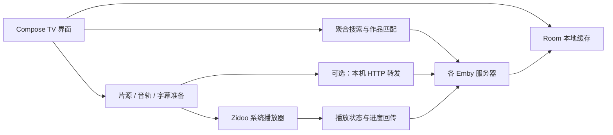

# 开发指南

[返回项目首页](../README.md)。以下命令均在仓库根目录执行。

工具链：**JDK 21**、**Android SDK Platform 36**。Gradle Wrapper 固定为 **8.14.3**，无需全局安装 Gradle。应用 `minSdk 28` / `targetSdk 30`；当前目标是侧载到芝杜设备。

设置 `JAVA_HOME` 与 `ANDROID_HOME`，或在不提交的 `local.properties` 中配置 `sdk.dir`。macOS/Linux 执行：

```bash
./gradlew :app:testDebugUnitTest :app:assembleDebug
adb install -r app/build/outputs/apk/debug/app-debug.apk
```

Windows 可将 `./gradlew` 换成 `gradlew.bat`。macOS 上已有 mise 的开发者也可使用仓库的 `mise.toml`（其中 SDK 路径为 macOS 默认位置）：

```bash
mise install
mise exec -- ./gradlew :app:testDebugUnitTest :app:assembleDebug
```

构建经过 R8 压缩的版本：

```bash
./gradlew :app:assembleRelease
```

未提供签名配置时，产物为 `app/build/outputs/apk/release/app-release-unsigned.apk`。正式发布使用独立发布密钥，通过 `ZMBY_SIGNING_PROPERTIES` 指向仓库外的私有配置：

```properties
storeFile=release.p12
storePassword=<your-store-password>
keyAlias=zmby-release
keyPassword=<your-key-password>
```

`storeFile` 相对于该配置文件所在目录，也可使用绝对路径。配置完成后构建：

```bash
ZMBY_SIGNING_PROPERTIES=/path/outside/repo/release.properties ./gradlew :app:assembleRelease
```

签名产物为 `app/build/outputs/apk/release/app-release.apk`。密钥与密码请单独备份，不要提交到 Git。GitHub Release APK 使用固定发布签名；从此前 debug 签名的开发版切换时，需要先卸载旧版（应用数据会随之删除）。

## 本地演示

没有真实服务器时，可使用自带 Python mock。仅需 Python 3 标准库：

```bash
python3 -I tools/mock_emby.py --multi
```

在 Android TV 模拟器中添加 `http://10.0.2.2:8096`，用户名和密码任意。额外服务器端口为 `8098`–`8102`，模拟多译名、缺失 ID、收藏拒写、慢服务器、离线和客户端限制。mock 会监听宿主机网络端口，只在可信的开发网络运行，结束后用 Ctrl+C 停止。

需要模拟外部播放器与进度回传时：

```bash
./gradlew :devtools:fake-zidoo-player:assembleDebug
adb -s emulator-5580 install -r devtools/fake-zidoo-player/build/outputs/apk/debug/fake-zidoo-player-debug.apk
adb -s emulator-5580 reverse tcp:9529 tcp:9529
```

将 `emulator-5580` 换成 `adb devices` 中的模拟器序列号。假播放器只用于验证 Intent 与进度协议，不解码视频。**不要安装到真实 Zidoo 设备上**：它使用系统播放器的兼容包名，可能发生冲突。

mock 加 `--many-tracks` 可让「沙丘：第二部」的 REMUX 版本提供 25 条音轨与 60 条字幕，用于验证卡内滚动。

mock 加 `--segments` 给「漫长的季节」各集加片头片尾标记，并让「奥本海默」有三个时长不同的版本（院线 180 分、加长 200 分、IMAX 190 分），各带自己的标记：前两个把章节列在版本上，IMAX 只在以 `ItemId` 取到的自身条目上，用于验证按播放版本取 Emby 标记。

宿主机代理或 VPN 拦截模拟器访问 `10.0.2.2` 时，可改走 adb 反向端口：`adb reverse tcp:8096 tcp:8096`，在服务器管理里给 mock 服务器添加线路 `127.0.0.1:8096`，并用 `adb shell setprop debug.zmby.fake_zidoo_base http://127.0.0.1:8096` 让假播放器回报状态。

mock 还支持 `--pinyin`、`--redirect`、`--sign-ttl`、`--require-ua`、`--video`、`--suggestions`（主推区建议接口的有无）和 `--trailer <MP4>`（假的 IMDb 预告片接口，调试构建用 `adb shell setprop debug.zmby.imdb_base http://10.0.2.2:8096/_mock/imdb` 指向它；测试视频请自行生成，例如 ffmpeg 的 `testsrc2`），`--trailer-hls <目录>`（烂番茄备选预告片的 HLS，用 ffmpeg 从测试 MP4 切出）、服务器本地预告片，另有虚构评分的 Wikidata 与烂番茄页面（`debug.zmby.wikidata_base http://10.0.2.2:8096/_mock/wikidata`、`debug.zmby.rt_base http://10.0.2.2:8096/_mock/rt/`），并提供相似作品、建议、电影推荐与一个只接受假令牌的最小 TMDB（调试构建用 `adb shell setprop debug.zmby.tmdb_base http://10.0.2.2:8096/_mock/tmdb/3/` 指向它）；用 `python3 -I tools/mock_emby.py --help` 查看参数。真实播放测试请使用你有权分发的测试视频，仓库不附带影片。

### 性能走查与请求计数

`tools/perf_walk.py` 在模拟器或设备上按固定遥控按键序列走查首页、详情、剧集页、搜索、浏览、在看与「我的」，每个场景报告 `dumpsys gfxinfo` 帧时间（p50 / p90 / p99、超过 33 ms 的帧，以及最近约 120 帧按阶段拆分的重组与动画、测量布局、绘制记录、渲染线程耗时）、调试构建记录的各区块重组次数，以及从详情返回首页到首帧、到焦点恢复的耗时。按键默认通过设备上常驻的 `monkey --port` 发送（一个进程，不像每次 `adb shell input` 那样与应用争抢 CPU）；设备有可写的虚拟输入设备时可用 `--input /dev/input/eventN` 改用 `sendevent`。场景路径按 `mock_emby.py --multi` 的数据编写，`--list` 列出场景。`box-` 开头的场景用于连着自己服务器的 Zidoo 盒子：详情与剧集页从电影 / 剧集网格的第一张海报进入，不在「在看」上按确认；盒子的 logcat 为空，用 `--settle <毫秒>` 代替等待首页日志；`--player-guard <盒子地址>` 从本机轮询播放器的 9529 状态，一旦意外起播就发送停止键并中止走查。盒子的虚拟输入设备没有 `KEY_BACK`，脚本用 `KEY_ESC`（系统回退为返回键）。

```bash
python3 -I tools/mock_emby.py --multi > /tmp/mock.log
```

```bash
python3 -I tools/perf_walk.py --serial emulator-5580 --mock http://127.0.0.1:8096 --out /tmp/walk.json
```

```bash
python3 -I tools/request_count.py /tmp/mock.log
```

`--mock` 让走查在每个场景开始时向 mock 打标记，`request_count.py` 据此按场景统计请求数、各服务器与端点的分布，并列出同一服务器重复请求的相同 URL；给出场景名可看单个场景的明细。Baseline Profile 由 `:baselineprofile` 模块生成：连接一台 Android 13 及以上（或已 root）的模拟器或设备，按上文导入 `mock_emby.py --multi` 的服务器后运行下面的命令，结果写入 `app/src/release/generated/baselineProfiles/`（随源码提交）。Android 11 的盒子未 root 时不能生成。同一模块的冷启动基准（不预编译与使用 Profile 各 4 次）用 `./gradlew :baselineprofile:connectedBenchmarkReleaseAndroidTest -Pandroid.testInstrumentationRunnerArguments.class=app.zmby.baselineprofile.StartupBenchmark`；在模拟器上它默认拒绝运行，只作参考时再加 `-Pandroid.testInstrumentationRunnerArguments.androidx.benchmark.suppressErrors=EMULATOR`。两者都只是测试模块，不进入 APK（其依赖 androidx.benchmark、uiautomator 均为 Apache-2.0，不随应用分发）。注意它们会在连接的设备上安装并在结束后卸载 `app.zmby`，设备上的服务器与缓存随之清空，只在专用模拟器上运行；`:baselineprofile:assemble` 也会触发这一步，只检查编译时用 `./gradlew :baselineprofile:compileNonMinifiedReleaseKotlin`。常规检查（`:app:` 的单元测试、lint 与构建）不连接设备。

```bash
./gradlew :app:generateBaselineProfile
```

Compose 编译器的可跳过性报告用 `./gradlew :app:assembleDebug -PcomposeReports` 生成到 `app/build/compose_reports`。模拟器帧时间只作相对比较。

## 代码结构



| 目录 | 职责 |
| --- | --- |
| `app/src/main/java/app/zmby/ui/` | 页面、导航、遥控焦点与 Compose 组件。 |
| `aggregate/`、`search/` | 并发扇出、作品合并、版本排序与拼音搜索。 |
| `emby/`、`data/` | Emby API、服务器注册表、媒体库与设置。 |
| `store/`、`favorites/` | Room 数据、元数据合并、收藏与待看。 |
| `playback/`、`zidoo/` | 播放准备、流地址、字幕、转发和 Zidoo 协议。 |
| `log/`、`net/` | 脱敏日志与小型 HTTP 服务。 |
| `app/src/test/` | JUnit、MockWebServer 与 Robolectric 测试。 |
| `devtools/fake-zidoo-player/`、`tools/mock_emby.py`、`tools/perf_walk.py`、`tools/request_count.py` | 模拟器测试、性能走查与请求计数工具。 |

表中包名目录均相对于 `app/src/main/java/app/zmby/`，完整目录除外。

## 参与开发

开发约定见 [AGENTS.md](../AGENTS.md)。提交前执行与改动相关的测试；完整本地检查：

```bash
./gradlew :app:testDebugUnitTest :app:lintDebug :app:assembleDebug :app:assembleRelease
```

修复播放问题时请提供设备型号、固件版本、复现步骤、预期与实际行为，并说明使用 mock 还是真实服务器。提交日志前请手工复查脱敏结果；不要公开账号、令牌、签名链接或私人服务器地址。
